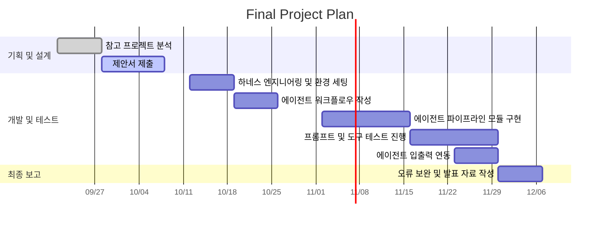

# 1. 프로젝트 개요

## 1.1. 기본 정보
- 프로젝트 제목 : 숏츠 제작을 위한 멀티 에이전트팀 개발
-  작성일자 : 2026-10-10
-  학번 /이름 : 20221703 / 박준호

구분 | 성명 | 학번 | 소속학과 | 깃허브 아이디
------|-------|-------|-------|-------
1 | 박준호 | 20221703 | 컴퓨터학과 | praksb2428-maker
2 | 작성 필요 | 작성 필요 | 작성 필요 | 작성 필요
3 | 작성 필요 | 작성 필요 | 작성 필요 | 작성 필요

# 2. 서론 및 배경

## 2.1. 배경
- 문제 정의 : 숏츠 영상을 반복해서 제작하려면 시청자 분석, 훅 설계, 대본 작성, 장면 연출, 영상 생성, 음성·자막 제작, 편집과 품질 검사까지 여러 작업을 거쳐야 한다. 각 단계를 따로 진행하면 시간이 오래 걸리고 영상마다 품질과 형식이 달라지기 쉽다.
- 제안 배경 : 사용자가 전달한 주제와 조건을 바탕으로 여러 AI 에이전트가 역할을 나누어 숏츠 기획부터 제작·검토까지 처리하는 에이전트팀을 개발하고자 한다. 영상 생성 전에 대상 시청자, 훅, 줄거리, 장면 구성과 예상 비용을 제시하고, 사용자의 피드백을 반영해 제작 내용을 확정하도록 한다.

## 2.2. 기여점
- 참고 프로젝트 주제 : CrewAI 공식 예제인 AI Crew for Screenwriting을 참고한다. 이 프로젝트는 스팸 필터, 분석가, 대본 작가, 포맷터, 평가자가 입력 문장을 분석하고 두 인물의 대화 중심 영화 대본을 순차적으로 작성한다.
- 기존 프로젝트와의 차별성 : 참고 프로젝트는 대화문과 평가 점수만 출력하지만, 제안 프로젝트는 콘텐츠 기획, 액션·비주얼 연출, 영상 프롬프트 작성, 제작과 품질 검토를 담당하는 에이전트를 설계해 하나의 흐름으로 연결한다. 참고 자료 검토는 사용자가 자료를 제공한 경우에만 진행한다. 영상 길이, 해상도와 자막 타이밍은 자동으로 검사하고, 인물·배경의 일관성과 음성 동기화는 사용자가 생성된 영상 파일을 재생해 확인하도록 한다. 확인을 마친 영상은 MP4와 관련 파일로 제공한다.

# 3. 상세 내용

## 3.1. 개발 목표 및 접근법
- 정량적/정성적 달성 목표 : 첫 구현 목표는 사용자가 전달한 주제 하나를 바탕으로 짧은 숏츠 영상 한 편을 완성하는 것이다. 주제, 목표 길이, 화면 비율, 스타일, 대상 시청자와 금지 요소를 확인한 뒤 숏츠 기획 요약을 생성한다. 승인된 기획안을 바탕으로 훅, 대본, 장면별 행동과 카메라 연출, 영상 생성 프롬프트를 만들고 최종적으로 MP4 영상, SRT 자막, 장면별 생성 정보와 품질 검사 결과를 제공하도록 한다. 각 장면에는 배경, 인물 행동, 카메라 구도와 장면 길이가 빠짐없이 포함되도록 하고, 최종 영상 길이는 사용자가 지정한 목표에서 ±10% 이내가 되도록 한다. 이 흐름을 검증한 뒤 다른 주제에도 같은 제작 과정을 반복 적용할 수 있도록 한다.
- 핵심 에이전트 루프 및 접근법 : Perception Layer에서는 사용자의 영상 조건, 선택적으로 제공한 참고 자료, 금지 요소, 예산과 누락 항목을 확인한다. Reasoning Layer에서는 콘텐츠 기획 에이전트가 시청자·훅·이야기 구조를 설계하고, 연출 에이전트가 행동·카메라·구도·조명·오디오를 구체화한 뒤 프롬프트 에이전트가 장면별 생성 프롬프트를 작성한다. Action Layer에서는 제작 에이전트가 승인 상태와 예상 비용을 확인하고 영상 생성 API, TTS, 자막 생성과 FFmpeg를 호출한다. Observation Layer에서는 품질 검토 에이전트가 입력 조건의 반영 여부를 검토하고 도구를 이용해 영상 길이, 해상도와 자막 타이밍을 검사한다. 인물·배경의 일관성, 음성 동기화와 내용의 적절성은 사용자 확인을 병행하며, 발견된 문제는 해당 단계로 돌려보내 수정하도록 한다.

## 3.2. 시스템 아키텍처

- 에이전트 워크플로우 : 사용자 입력 → 콘텐츠 기획 에이전트(시청자·훅·이야기 구조) → 사용자 기획 승인 → 액션·비주얼 연출 에이전트(행동·표정·카메라·구도·조명·오디오) → 영상 프롬프트 에이전트 → 사용자 최종 프롬프트 및 예상 비용 확인·제작 승인 → 제작 에이전트(영상·음성·자막 생성 및 FFmpeg 조립) → 품질 검토 에이전트의 자동검사 및 사용자 영상 파일 확인 → 문제가 있으면 해당 단계 수정 → 최종 결과 제공 순서로 구성한다. 참고 자료를 제공한 경우에만 기획 과정에서 출처와 사용자가 제시한 사용 가능 범위를 검토하고, 불명확한 부분은 사용자에게 확인한다. 참고 자료가 없어도 전체 제작 흐름을 진행할 수 있도록 한다. 에이전트 사이의 결과는 자유 형식의 문장 대신 JSON으로 전달해 장면 누락과 형식 오류를 줄인다. 대본이나 장면 정보가 누락되면 기획·연출 단계로, 프롬프트에 제작 조건이 빠지면 프롬프트 작성 단계로, 자막 타이밍이나 영상 길이에 오류가 있으면 제작·편집 단계로 돌려보내도록 한다. 인물·배경의 일관성 문제는 사용자 확인 후 연출과 프롬프트를 검토하고 재생성 여부를 결정한다. 수정된 결과와 영향을 받는 후속 단계는 다시 검토하며, 제작 내용이 바뀌면 해당 내용에 대한 사용자 승인을 다시 받도록 한다. 유료 영상 또는 음성 재생성이 필요한 경우에는 추가 비용을 안내하고 사용자 승인을 받은 뒤 진행하도록 한다.

## 3.3. 입출력 인터페이스

- 입력 형태 : 영상 주제, 목표 길이, 화면 비율, 영상 스타일, 대상 시청자, 금지 요소와 최대 예산을 텍스트 또는 구조화된 데이터로 에이전트에 전달한다. 참고 자료는 선택적으로 추가하되 출처와 사용 가능 범위를 함께 기록한다. 에이전트는 기획안, 프롬프트와 예상 비용을 반환하고, 사용자의 수정 요청이나 제작 승인에 따라 다음 작업을 진행하도록 한다.
- 최종 형태 : 에이전트 실행 결과로 완성된 MP4 영상과 SRT 자막 파일을 저장한다. 콘텐츠 기획안, 액션·비주얼 연출안, 장면별 프롬프트와 생성 정보를 담은 JSON 파일, 품질 검사 결과 및 결과 파일 경로도 함께 반환하도록 한다.

# 4. 개발 환경

## 4.1. 모델 및 예상 비용
- 기반 LLM 모델 : 기획, 대본과 프롬프트 작성에는 OpenAI의 gpt-4o-mini 사용을 우선 검토한다. 영상 생성에는 텍스트-투-비디오 또는 이미지-투-비디오 API를 연결할 예정이며, 실제 개발 전에 지원 기능과 비용을 비교해 모델을 확정한다.
- 예상 API 비용 : 구체적인 비용과 개발 예산은 영상 생성 API, 영상 길이와 장면 수를 정한 뒤 산정할 예정이다. 초기에는 짧은 저해상도 영상과 적은 장면 수로 테스트하고, 실제 사용량과 비용을 기록한다. 제작 전에는 예상 비용을 안내하고 사용자가 지정한 최대 예산을 기준으로 실행 가능 여부를 확인하도록 한다. 유료 영상 또는 음성 재생성이 필요한 경우에는 추가 비용을 안내하고 사용자의 승인을 받도록 한다.

## 4.2. 프레임워크 및 연계 기술
- 에이전트 프레임워크 : 참고 프로젝트의 역할 분리와 순차 전달 구조를 바탕으로 콘텐츠 기획, 액션·비주얼 연출, 프롬프트 작성, 제작과 품질 검토 에이전트를 설계한다. CrewAI를 구현 후보로 검토하고, 에이전트 간 JSON 전달, 사용자 승인 후 작업 재개, 외부 제작 도구 호출을 시험한 뒤 실행 방식과 프레임워크를 확정할 예정이다.
- 모델 외 연계 기술 : Function Calling과 Tool Use를 이용해 영상·음성·자막 생성 도구를 호출한다. 에이전트 사이의 데이터는 버전이 있는 JSON 스키마로 관리하고, 작업 상태, 사용자가 승인한 기획안과 프롬프트, 예상 비용을 저장한다. 승인 이후 내용이 바뀌면 다시 검토하도록 하며, 현재 범위에서는 RAG와 벡터 데이터베이스를 사용하지 않는다.
- 외부 연동 도구 및 API : OpenAI API를 기획·대본 생성과 TTS에 사용하고, 영상 생성 API는 비교 후 선정한다. FFmpeg를 이용해 장면, 음성, 배경음과 자막을 결합한다.

## 4.3. 실행 환경
- 개발 언어 및 환경 : Python 3.12 가상환경과 Visual Studio Code를 사용하며, Git과 GitHub로 코드와 문서의 변경 이력을 관리한다.
- 주요 라이브러리 및 배포 도구 : `openai`, `pydantic`, `python-dotenv`와 FFmpeg를 사용하고, CrewAI를 채택하는 경우 `crewai`를 추가할 예정이다. 에이전트별 역할과 도구 호출, JSON 입출력 검증, 작업 상태 기록 및 결과 파일 저장 기능을 구현한다.

# 5. 수행 계획

## 5.1. 개발 일정
- 6~7주차 : 참고 프로젝트를 분석하고 프로젝트 주제, 사용자 입력 항목, 에이전트 역할과 전체 워크플로우를 설계한다.
- 9~12주차 : Python 가상환경과 API 설정을 마치고 에이전트 실행 방식과 프레임워크를 시험한 뒤 확정한다. 콘텐츠 기획, 액션·비주얼 연출, 프롬프트 작성, 제작과 품질 검토 에이전트를 구현하고, JSON 전달 구조와 영상·음성·자막 생성 도구를 연결해 테스트한다.
- 12~14주차 : 에이전트 간 입출력 연동과 FFmpeg 편집 기능을 완성하고, 오류별 수정 단계와 품질 검사 과정을 보완한다. 주제 하나로 숏츠 영상 한 편과 관련 파일이 생성되는 전체 흐름을 검증하고 최종 시연 영상과 발표 자료를 준비한다.

# 6. 참고 문헌
- 논문 : 현재 단계에서는 별도 논문을 사용하지 않았으며, 오픈소스 예제와 공식 문서를 중심으로 참고한다.
-  오픈소스 저장소(Github URL) : https://github.com/crewAIInc/crewAI-examples/tree/main/crews/screenplay_writer
-  기타 데이터셋 출처 URL : CrewAI 공식 문서 https://docs.crewai.com/ / OpenAI API 공식 문서 https://platform.openai.com/docs / FFmpeg 공식 문서 https://ffmpeg.org/documentation.html
