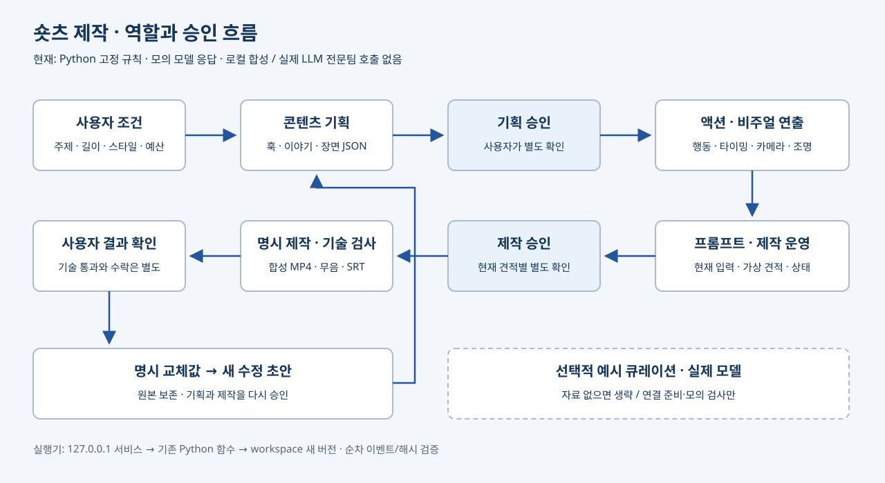
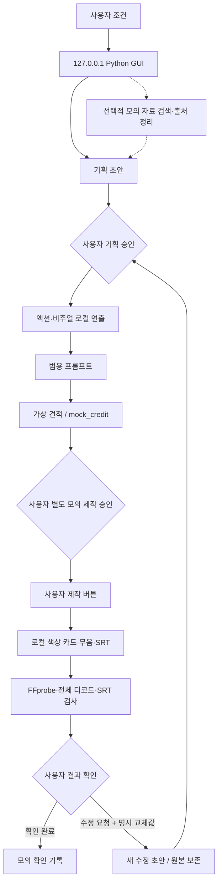

# 역할과 실행 아키텍처

그림의 역할은 설계상 책임이다. 현재 구현은 고정 Python 함수·메모리 모의 응답·로컬 FFmpeg이며 여러 LLM 팀이 실제 대화하거나 실행된 구조가 아니다.

## 역할·입출력·현재 연결

| 설계 책임 | 입력 → 출력 | 현재 구현 |
| --- | --- | --- |
| 콘텐츠 기획 | 주제·조건·선택적 모의 자료 → 훅·스토리·장면 초안 | 기존 네 기획 방식과 선택 문맥; 실제 로컬 모델의 자료 반영은 이번에 mock transport로만 검사 |
| 예시 큐레이터 | 선택적 참고 자료 → 출처·사용 범위·패턴 | 명시 모의 검색이 고정 합성 자료·출처를 정리하며 미사용 시 생략; 실제 외부 자료 검토는 미연결 |
| 액션 연출 | 승인 기획 → 행동·장면 길이 | `create_direction`에 포함한 로컬 규칙 |
| 비주얼 연출 | 승인 기획 → 카메라·조명·오디오 | 같은 `create_direction`, 미정 부분은 local_default |
| 영상 프롬프트 | 현재 기획·연출 → 장면 프롬프트 | `create_prompts`, 제공자 중립 |
| 제작 운영 | 기획·프롬프트·가상 단가 → 견적·별도 승인·상태 | `mock_production`과 GUI append-only 이벤트 |
| 숏츠 제작 | 유효한 모의 승인 → MP4·SRT·장면/품질 JSON | `produce_mock_media` 또는 `produce_rework_mock` |
| 품질 검토 | 현재 파일·입력 → 기술 검사·명시 확인·수정 요청 | 실제 도구 검사와 사용자 기록, LLM 독립 내용 검토는 미구현 |

## 실제 서비스 경로

화면의 요청은 고정 action·서버 발급 작업 ID·현재 이벤트 번호만 전달한다. 서버가 workspace 아래 고정 파일명을 정하고 기존 함수가 승인·입력 결속을 다시 검사한다. 임의 파일 경로·셸·외부 URL을 요청에서 받아 실행하지 않는다.

작업은 `workspace/gui/<서버발급ID>/r0001`, `r0002`처럼 새 버전으로 저장한다. `events/`의 순차 기록은 이전 이벤트 해시와 산출물 SHA-256을 결속한다. 새로고침과 서버 재시작은 이를 읽어 재개할 뿐 자동 승인·제작하지 않는다. 해시는 변경 감지이며 인증·전자서명이 아니다. 단일 로컬 사용자 시연용이며 서비스 공개/배포용 인증을 제공하지 않는다.

로컬 모델 어댑터는 고정 loopback 요청 형태를 `httpx.MockTransport`에만 보낸다. 실제 서버·모델은 미선정이며 GUI에서 live transport로 바꾸는 스위치는 없다. 실제 연결은 모델·런타임·입력·권한을 확정한 후 별도 검증한다.

위 마지막 문단은 초기 모의 어댑터의 범위다. 후속 [로컬 기획 결정](decisions/0014-local-ollama-planning.md)에서 선정한 Ollama/Qwen의 명시 실제 생성은 별도 경로이며 기존 동작을 유지한다. 이번 [선택 자료 조사](decisions/0017-optional-mock-research.md)는 실제 검색 없이 합성 packet과 서버 저장 ID를 사용한다. 새 선택 research 필드는 자료·조건을 검증하고 기획 승인 해시에 포함하며 revision에서는 보존한다. 조회·승인·준비·제작은 조사 도구를 다시 호출하지 않는다.
