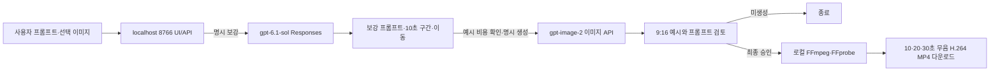

# 현재 영상 작업실 아키텍처

2026-11-24 사용자 결정으로 이전 8765 GUI·CLI·모의 제작 **실행 코드와 전용 테스트·예제**를 제거했다. 초기 구상 하네스의 스킬·안내는 이력으로 보존한다. 실행 진입점은 `storyboard_web.py` 하나다. [제거 결정](decisions/0021-remove-legacy-runtime.md) · [역공학 설계 문서](reverse-engineering/README.md) · [HTML 구조도](architecture.html)

| 계층 | 파일 | 책임과 경계 |
| --- | --- | --- |
| 입력·화면 | `storyboard_web.py`, `web/storyboard.html`, `.css`, `.js` | 127.0.0.1 고정 서버, Host/Origin/CSRF 확인, 입력 크기·형식 제한, 구간 프롬프트와 예시 동시 표시, 비용·최종 승인 안내, 고정 경로 다운로드 |
| 상태·승인 | `src/storyboard_flow.py` | 서버 발급 작업 ID, `workspace/storyboards/`의 상태와 파일, 10초 구간 계약, 승인·파일 SHA-256 변경 감지, 실패 시 중단 |
| 외부 모델 | `src/storyboard_openai.py` | 서버 환경 또는 `.env`의 키, 고정 OpenAI HTTPS endpoint·모델, GPT 구조화 응답 검증, 첨부 이미지가 있으면 이미지 편집 API 사용 |
| 로컬 제작 | `src/storyboard_render.py` | 승인된 PNG를 각 10초 구간 H.264로 이동·확대 합성해 연결, FFprobe로 길이·해상도·코덱 확인 |
| 검사·하네스 | `tests/test_storyboard.py`, `tests/test_architecture_sync.py`, `scripts/check_architecture_sync.py`, `.agents/skills/` | 합성·모의 HTTP 및 설치된 로컬 FFmpeg 검사, 설계 문서 동반 변경 확인 |

## 데이터와 승인 흐름

1. 프롬프트 1~2000자, 길이 10·20·30초, 선택적 PNG/JPEG/WebP 최대 5MB를 검증하고 작업 ID를 만든다. 자동 API 호출은 없다.
2. 사용자가 보강 버튼을 누르면 GPT가 전체 프롬프트와 정확히 1~3개의 10초 구간 프롬프트·`zoom_in`/`zoom_out`/`pan_left`/`pan_right`를 제안한다. 서버가 응답 형식·길이를 다시 검사한다.
3. 사용자가 구간을 보고 예시 이미지 출력 비용 참고값을 확인한 뒤 생성 버튼을 누른다. 첨부 이미지는 프롬프트 보강과 각 이미지 편집 요청의 기준으로 전송된다. 구간당 PNG 한 장을 저장한다. 2:3 원본을 화면에서는 MP4의 9:16 기본 구도로 중앙 잘라 보여주며 이동 중 가장자리가 더 잘릴 수 있다고 알린다.
4. 사용자가 미생성을 선택하면 종료한다. 모든 프롬프트와 예시를 검토해 최종 승인한 경우에만 승인 내용을 해시로 결속하고 FFmpeg를 실행한다. 10초 구간을 연결해 MP4를 제공한다. 결과는 정지 이미지의 카메라 효과이며 연속 동작 생성 영상은 아니다.

작업 상태는 `draft → planning → planned → previewing → preview_ready → rendering → ready`다. `declined`, `plan_failed`, `preview_failed`, `render_failed`는 중단 상태다. 조회·새로고침·재시작은 API나 렌더를 재실행하지 않는다. 실패 후 자동 재시도·공급자 fallback은 없다. 새 작업을 시작해야 한다. 승인 내용·원본·예시·MP4의 해시는 변경 감지이며 사용자 신원 인증이 아니다.

키는 서버에서만 읽고 작업 JSON·웹 응답·로그에 넣지 않는다. 원본·예시·MP4는 Git 제외 `workspace/storyboards/<서버 발급 ID>/`에 보관한다. OpenAI 보강/예시 요청은 유료일 수 있고 응답 실패에도 비용이 발생할 수 있다. 화면의 이미지 단가는 출력 참고값이며 입력·보강 비용 또는 비용 상한이 아니다. 최종 FFmpeg 단계는 추가 영상 API를 부르지 않는다. 실제 OpenAI 유료 호출과 이미지 품질은 아직 검증하지 않았다.

## 문서·결정 경계

- [제안서](../Video_Production_Project.md)는 원본으로 남긴다. 현재 구현과 제안서 전체 범위의 차이는 [브리프](project-brief.md)에 적는다.
- [ADR 0020](decisions/0020-gpt-storyboard-local-mp4.md)은 GPT 지휘·예시 이미지·로컬 MP4 선택이다. [ADR 0021](decisions/0021-remove-legacy-runtime.md)은 이전 실행 코드 제거와 초기 하네스 보존 결정이다. 과거 ADR·보고서와 [초기 하네스](harness.md)는 당시 구현의 기록이며 현재 런타임을 설명하지 않는다.
- 구현·프로젝트 스킬·의존성 변경은 `AGENTS.md` 또는 이 문서를 동반 갱신한다. 설계 동기화 가드는 변경 **존재**만 확인한다. 별도 검토자가 실제 코드·문서·HTML 일치를 판단한다.
