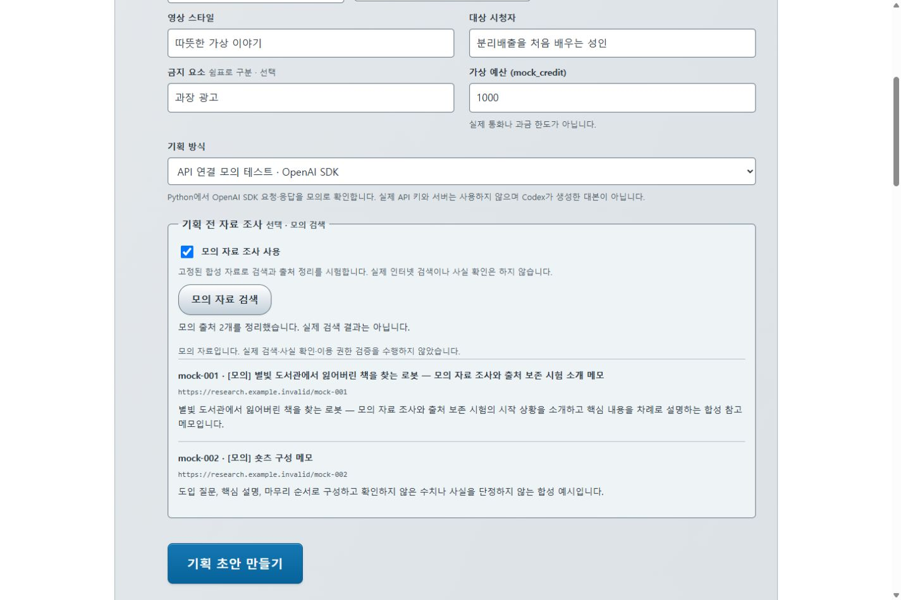
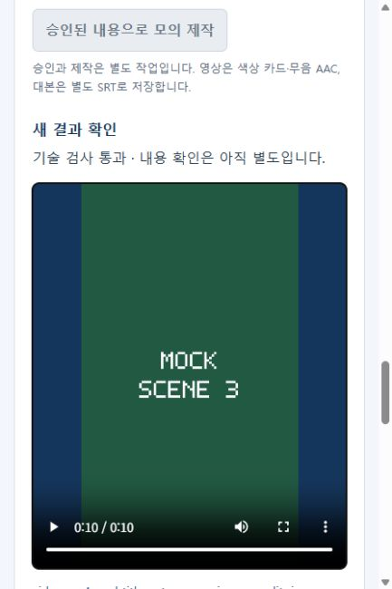

# 1. 프로젝트 개요

## 1.1. 기본 정보

- 프로젝트 제목 : 숏츠 제작을 위한 멀티 에이전트팀 개발
- 작성일자 : 2026-11-16
- 학번 / 이름 : 미기재

# 2. 현재까지 진행된 사항

## 2.1. 데이터 및 개발 환경 구축 현황

- 데이터셋 준비 상태 : 모델을 직접 학습하는 프로젝트가 아니므로 별도의 학습 데이터셋은 구축하지 않았다. 영상 주제, 길이, 화면 비율, 스타일, 대상 시청자, 금지 요소, 가상 예산을 담은 입력 예제와 정상·오류 응답을 시험할 합성 데이터를 준비했다.
- 데이터 전처리 및 증강 : 이미지 증강 대신 입력 조건과 장면별 대본·행동·구도·길이를 JSON으로 정리하고, 필수 항목 누락과 형식 오류를 검사하도록 했다. 선택한 모의 참고 자료의 제목·주소·요약도 기획과 함께 저장한다.
- 개발 환경 세팅 : Windows에서 Python 3.12 가상환경을 구성했다. OpenAI SDK와 httpx의 모의 응답 환경, FFmpeg·FFprobe를 연결했고, Ollama 0.40.16과 qwen3.5:4b-q4_K_M으로 로컬 기획·대본 생성을 확인했다. CLI와 웹 GUI에서 같은 Python 처리 구조를 사용한다.

## 2.2. 모델 개발 및 실험 결과

- 모델 파이프라인 구축 : 주제·조건 입력 → 기획·대본 생성 → 사용자 기획 승인 → 장면별 연출·프롬프트 정리 → 가상 견적 → 별도 모의 제작 승인 → 명시적 제작 실행 → 결과 검사·확인까지 연결했다. 수정 요청이 들어오면 원본을 보존하고 새 기획을 만든 뒤 두 승인을 다시 받는다. 에이전트별 역할과 JSON 전달 구조는 설계했으며, 현재 실행은 Python 순차 처리 방식이다. 연출·프롬프트는 로컬 규칙으로 구성하고, 여러 LLM 에이전트가 각각 판단하는 실행 구조는 아직 연결하지 않았다.
- 초기 실험(베이스라인) 결과 : GUI에서 실제 로컬 모델로 한국어 훅·줄거리·3개 장면의 대본을 생성했다. 이후 두 승인을 거쳐 10초·360×640 모의 MP4를 제작하고 브라우저에서 끝까지 재생했다. MP4, SRT, 장면 JSON, 품질 검사 결과와 파일 목록을 저장하며, 영상 길이·해상도·자막 타이밍·파일 손상 여부 등을 검사한다. 2026-11-16 최신 기능 검증에서는 전체 테스트 143개가 통과했다. 영상은 색상 카드와 무음 오디오를 합성한 시험 결과이며, 실제 AI 영상·음성 생성이나 대본의 내용 품질을 검증한 결과는 아니다.
- 중간 결과물 예시 : 선택형 모의 자료 조사 화면과 승인 후 제작한 모의 영상의 재생 화면이다.

그림 1. 선택형 모의 자료 조사 화면. 실제 인터넷 검색 결과가 아닌 고정된 합성 자료를 사용한다.

그림 2. 로컬 모델의 기획·대본 생성과 두 승인 이후 제작한 10초 모의 영상. 색상 카드와 무음 오디오로 구성했다. 이 화면은 UI 개편 전 기능 시험에서 촬영했다.

## 2.3. 이슈 사항

- 발생한 문제 : 로컬 모델 연결 초기에 장면 목록의 JSON 규격이 거부됐다. 생성된 대본에도 사실 확인이 필요한 표현이 있었다. 현재 실제 AI 영상 생성·TTS와 인터넷 검색은 연결하지 않았으며, 브라우저 자체 200% 확대 검증도 남아 있다.
- 원인 분석 : Ollama가 지원하지 않는 JSON 규격을 요청했고, 형식 검사만으로는 대본의 사실성과 적절성을 판단할 수 없었다. 비용 없이 개발하기 위해 외부 영상·음성 API와 검색은 모의 방식으로 구성했다. 200% 확대는 자동화 도구에서 대상 브라우저를 직접 조작할 수 없어 확인하지 못했다.
- 해결 방안 : JSON 규격을 호환되는 형태로 수정하고 실제 로컬 생성을 다시 확인했다. 대본은 사용자 확인 전까지 미승인 상태로 두고, 기획과 제작 승인을 분리했다. 모의 결과와 실제 생성 결과를 화면에서 구분하고, 실제 제작 도구 연결은 사용 범위와 비용을 별도로 정한 뒤 진행한다. 확대 검증은 직접 조작 가능한 브라우저에서 추가 확인할 예정이다.

# 3. 변경 사항

## 3.1. 변경 목표 및 범위

- 변경 전 : 외부 LLM·영상 생성 API·TTS를 연결해 숏츠 한 편의 기획부터 실제 영상 제작까지 처리하는 것을 목표로 했다.
- 변경 후 : 최종 목표는 유지하되, 중간 단계는 로컬 모델의 실제 기획·대본 생성과 비용 없는 모의 제작·검증에 집중했다. 사용자가 흐름을 확인할 수 있는 GUI와 선택형 모의 자료 조사·출처 저장 기능을 추가했다.
- 변경 사유 : 실제 과금 없이 승인·수정·재제작 흐름을 먼저 검증하고, 외부 제작 도구를 연결하기 전에 오류 처리와 결과 저장 구조를 갖추기 위해서다.

## 3.2. 변경 방법론 및 아키텍처

- 변경 내용 : 제안서에서 우선 검토했던 외부 LLM 대신 로컬 Qwen 모델로 기획·대본을 실제 생성하도록 했다. OpenAI SDK는 실제 API 키나 서버를 사용하지 않는 모의 응답 경로로 준비했다. CrewAI 도입은 확정하지 않고 기존 Python 구조를 유지했으며, 개발 과정은 계획 → 작성 → 검증 → 별도 검토 → 문서화로 나눴다. 계획·검증·문서화 절차는 .agents/skills/에 정리하고 직접 읽어 수행한 기록을 남겼다. 자료 조사는 기본 꺼짐 상태의 보조 기능이며, 실제 웹 검색이나 RAG 벡터 DB는 사용하지 않는다. Codex의 실제 API·SDK 연결도 현재 구현 범위에 포함되지 않는다.

# 4. 향후 계획

## 4.1. 세부 개발 일정

- 9~10주차 : 로컬 기획·대본 생성부터 두 승인, 모의 제작, 결과 확인, 수정·재승인까지 여러 주제로 점검한다. 승인 만료·잘못된 입력·파일 변경 등 오류 상황과 브라우저 200% 확대를 확인한다.
- 11~12주차 : 대본·장면·프롬프트가 입력 조건을 제대로 반영하는지 확인하고, 영상 길이와 자막 타이밍 등 검사 결과를 정리한다. 실제 영상·음성 생성은 도구·비용·사용 범위를 별도로 결정한 경우에만 연결하며, 그전까지는 모의 제작을 유지한다.
- 13~14주차 : 남은 오류를 수정하고 실행 방법, 테스트 결과, 구현 범위와 한계를 문서화한다. 실제 로컬 대본 생성과 승인·모의 제작 흐름을 보여주는 시연 영상과 최종 보고서·발표 자료를 준비한다.
