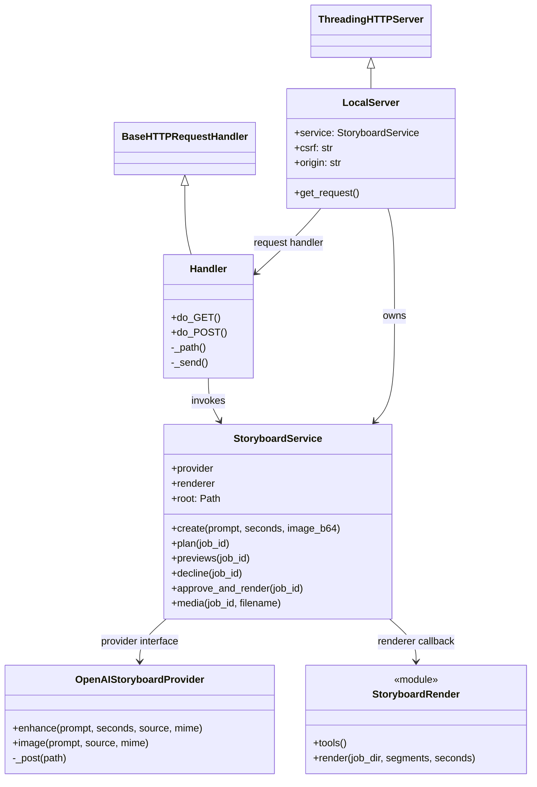

# 클래스·모듈 다이어그램

Python에는 HTTP 서버와 처리기, 작업 서비스, OpenAI 제공자의 네 주요 클래스가 있다. FFmpeg 렌더러는 클래스가 아닌 함수 모듈이므로 그렇게 표시했다. [서버 클래스](../../storyboard_web.py#L40) · [서비스 클래스](../../src/storyboard_flow.py#L39) · [제공자 클래스](../../src/storyboard_openai.py#L58)

| 구성 요소 | 책임·실제 결합 | 근거 |
| --- | --- | --- |
| `LocalServer`·`Handler` | 서버가 서비스와 CSRF를 소유한다. Handler는 고정 GET/POST 경로를 서비스 메서드로 연결한다. | [생성자](../../storyboard_web.py#L44), [GET/POST](../../storyboard_web.py#L92) |
| `StoryboardService` | 작업 상태·파일 무결성·승인 순서를 관리하고 제공자/렌더러를 생성자에서 주입받는다. | [생성자·읽기](../../src/storyboard_flow.py#L40), [전환](../../src/storyboard_flow.py#L152) |
| `OpenAIStoryboardProvider` | 구조화 GPT 응답과 이미지 API를 고정 endpoint·모델로 호출한다. | [제공자](../../src/storyboard_openai.py#L58) |
| `StoryboardRender` 모듈 | FFmpeg 실행 파일을 찾고 PNG를 10초 MP4 조각·최종 결과로 합성한다. | [함수](../../src/storyboard_render.py#L20), [렌더](../../src/storyboard_render.py#L64) |

`StoryboardService`는 특정 OpenAI 클래스의 상속형 인터페이스를 선언하지 않고 `enhance`·`image` 메서드를 가진 객체를 사용한다. 테스트에서는 같은 메서드를 가진 가짜 제공자를 주입한다. [서비스 생성자](../../src/storyboard_flow.py#L40) · [테스트 가짜 제공자](../../tests/test_storyboard.py#L32)
