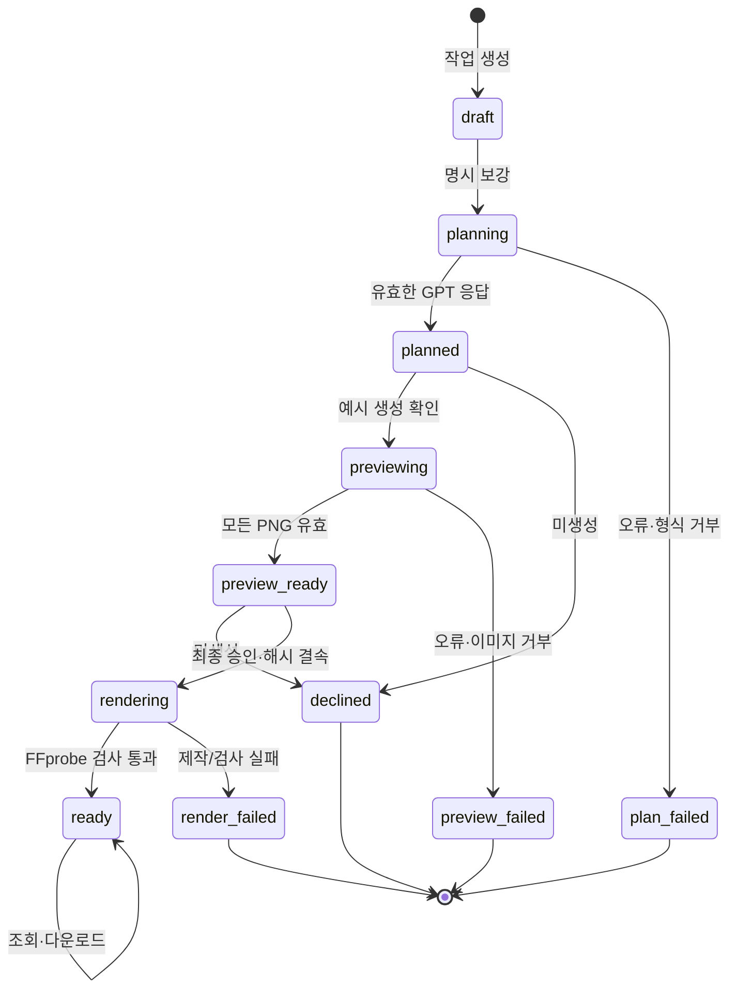

# 작업 데이터와 상태 수명주기

데이터베이스는 없다. [StoryboardService](../../src/storyboard_flow.py#L39)는 Git 제외 `workspace/storyboards/<서버 발급 32자리 hex ID>/`에 JSON과 미디어 파일을 둔다. `state.new`를 쓴 뒤 `state.json`으로 교체한다. [경로와 저장](../../src/storyboard_flow.py#L14) · [작업 ID](../../src/storyboard_flow.py#L136) · [원자적 교체](../../src/storyboard_flow.py#L96)

| 파일/필드 | 의미·수명 | 근거 |
| --- | --- | --- |
| `state.json` | 버전, ID, 원래 프롬프트·목표 초, 단계, 보강 프롬프트, 구간 목록, 승인/영상 기록. 새로고침·재시작 시 읽는다. | [초기 상태](../../src/storyboard_flow.py#L147), [읽기](../../src/storyboard_flow.py#L55) |
| `source.png/jpg/webp` | 사용자가 첨부한 선택 원본. MIME/고정 파일명과 SHA-256을 기록해 변경을 감지한다. | [생성](../../src/storyboard_flow.py#L121), [재검사](../../src/storyboard_flow.py#L61) |
| `preview-NN.png` | 10초 구간별 대표 이미지 1장. 구간 프롬프트·시작/끝·motion과 연결한다. | [생성](../../src/storyboard_flow.py#L192), [재검사](../../src/storyboard_flow.py#L74) |
| `approval_sha256` | 최종 승인 시 프롬프트·길이·원본 해시·보강 내용·구간/예시 기록을 묶는다. 사용자 인증은 아니다. | [생성](../../src/storyboard_flow.py#L233), [확인](../../src/storyboard_flow.py#L82) |
| `part-NN.mp4`, `parts.txt`, `video.mp4` | FFmpeg 구간 조각·연결 목록·최종 영상. 최종 영상 해시는 다운로드 전 확인한다. | [렌더](../../src/storyboard_render.py#L64), [미디어](../../src/storyboard_flow.py#L269) |

실패·거절 상태에서 같은 작업을 자동 재실행하는 전환은 없다. 사용자는 새 작업을 만든다. 부분 이미지/렌더 파일이 실패 작업 폴더에 남을 수 있으므로 결과 보존·삭제 기간은 아직 정하지 않았다. [전환 구현](../../src/storyboard_flow.py#L152) · [UI 새 작업](../../web/storyboard.js#L23)

**경계:** 상태·파일 해시는 우발적 변경 감지이고 접근 제어/신원 인증은 아니다. 서버는 127.0.0.1에서만 듣는다. [서버 바인딩](../../storyboard_web.py#L44)
