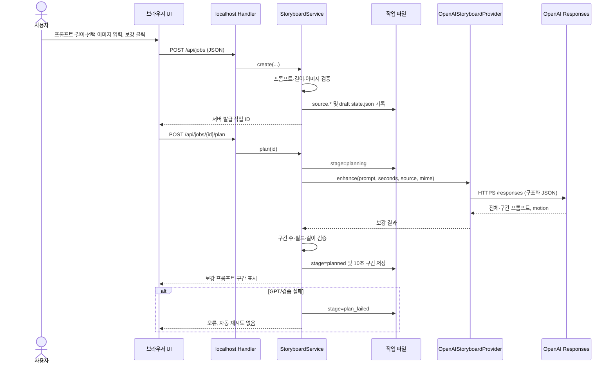

# 입력과 프롬프트 보강 시퀀스

사용자는 10·20·30초 길이와 선택 이미지를 입력한다. 하나의 **프롬프트 보강하기** 버튼이 먼저 로컬 작업을 만들고 이어 GPT 보강을 요청한다. 작업 생성 자체는 유료 API를 호출하지 않는다. [UI 제출](../../web/storyboard.js#L19) · [작업 생성](../../src/storyboard_flow.py#L121)

서버는 10·20·30초에서 정확히 1·2·3개 구간과 네 가지 허용 `motion`만 수락한다. 실패 뒤 같은 작업의 보강을 자동 재실행하지 않는다. [구간 검사](../../src/storyboard_flow.py#L164) · [실패 상태](../../src/storyboard_flow.py#L185)

**외부 경계:** 선택 이미지는 `input_image` base64로 GPT 요청에 포함된다. 키는 서버에서만 읽는다. 실제 GPT 응답 품질과 유료 사용은 미검증이다. [요청 구성](../../src/storyboard_openai.py#L82)
