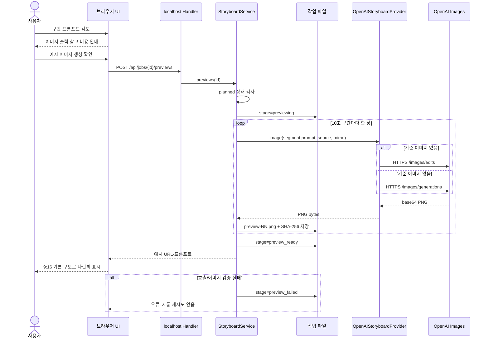

# 예시 이미지 생성·검토 시퀀스

`planned` 상태에서 사용자가 구간 프롬프트를 보고 출력 이미지 비용 참고값을 확인한 뒤 예시 생성을 선택한다. 기준 이미지가 있으면 각 구간은 이미지 편집 API를, 없으면 이미지 생성 API를 사용한다. [UI 비용 확인](../../web/storyboard.js#L20) · [API 분기](../../src/storyboard_openai.py#L117)

화면은 2:3 PNG의 중앙을 MP4 기본 비율인 9:16로 잘라 보여준다. 최종 카메라 이동 중에는 가장자리가 더 잘릴 수 있다고 알린다. [화면 CSS](../../web/storyboard.css#L1) · [안내](../../web/storyboard.html#L33)

예시 출력 참고비용은 코드에서 구간 수에 단가를 곱해 표시한다. **총 청구액이나 상한이 아니다.** 길이를 $T$초, 이미지 수를 $n=T/(10\,\mathrm{s})$라 두면 화면의 출력 참고액은 다음과 같다. [서버 단가](../../storyboard_web.py#L104) · [UI 계산](../../web/storyboard.js#L10)

$$
C_{\mathrm{image,out,ref}}=(0.041\,\mathrm{USD/image})\,n.
$$

입력 텍스트·기준 이미지와 GPT 보강 비용은 위 식에 포함되지 않는다. 실제 과금은 미검증이다.
