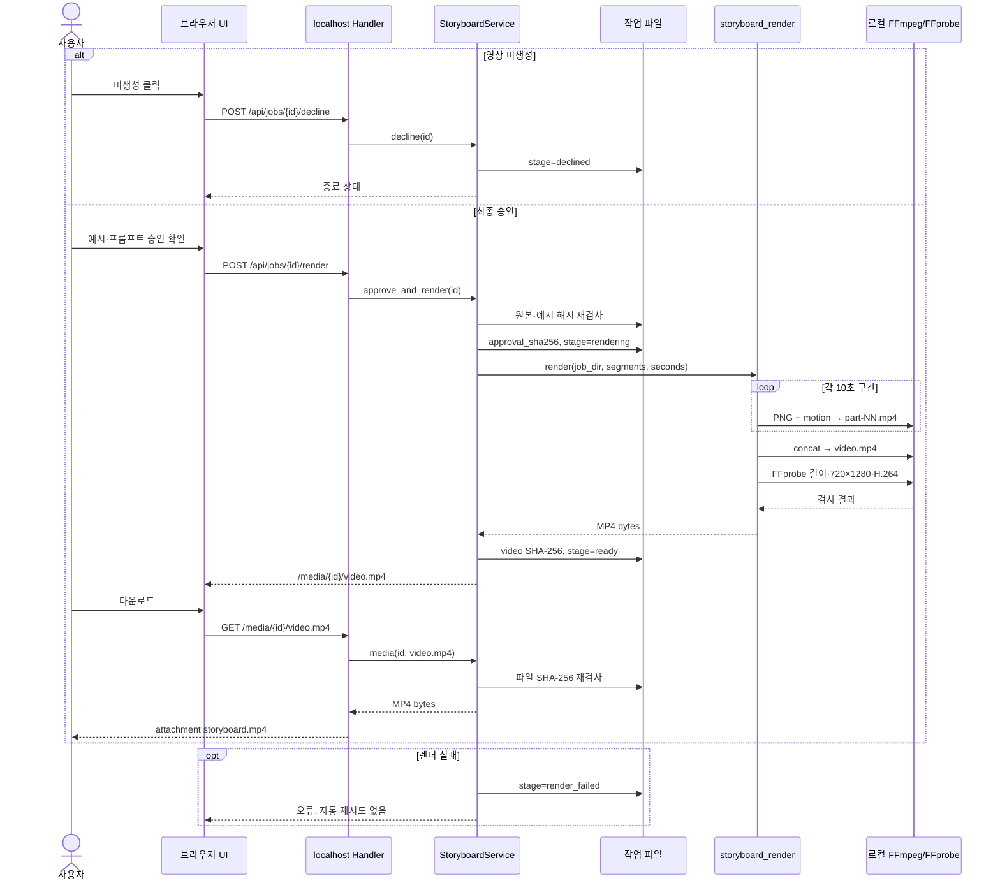

# 최종 결정·MP4 다운로드 시퀀스

사용자는 모든 예시 이미지와 프롬프트를 본 뒤 **영상 미생성** 또는 **최종 승인**을 선택한다. 서버는 `preview_ready`와 원본·예시 파일의 해시를 다시 확인하고, **그 시점에** 승인 내용의 해시를 생성한 후 렌더를 실행한다. [UI 선택](../../web/storyboard.js#L21) · [서버 승인](../../src/storyboard_flow.py#L233)

렌더러는 24fps에서 구간당 정확히 10초 분량을 요청한다. [상수](../../src/storyboard_render.py#L15) · [렌더 명령](../../src/storyboard_render.py#L64)

$$
N_{\mathrm{frames/segment}}=(10\,\mathrm{s})(24\,\mathrm{frames/s})=240\,\mathrm{frames}.
$$

FFprobe는 최종 MP4의 길이, 720×1280 해상도, H.264 코덱을 코드 내부에서 검사한다. 30초 합성은 로컬 테스트로 확인했으나 10·20초 실제 렌더와 사용자의 시청·수락은 미확인이다. [검사 코드](../../src/storyboard_render.py#L82) · [테스트](../../tests/test_storyboard.py#L213)
