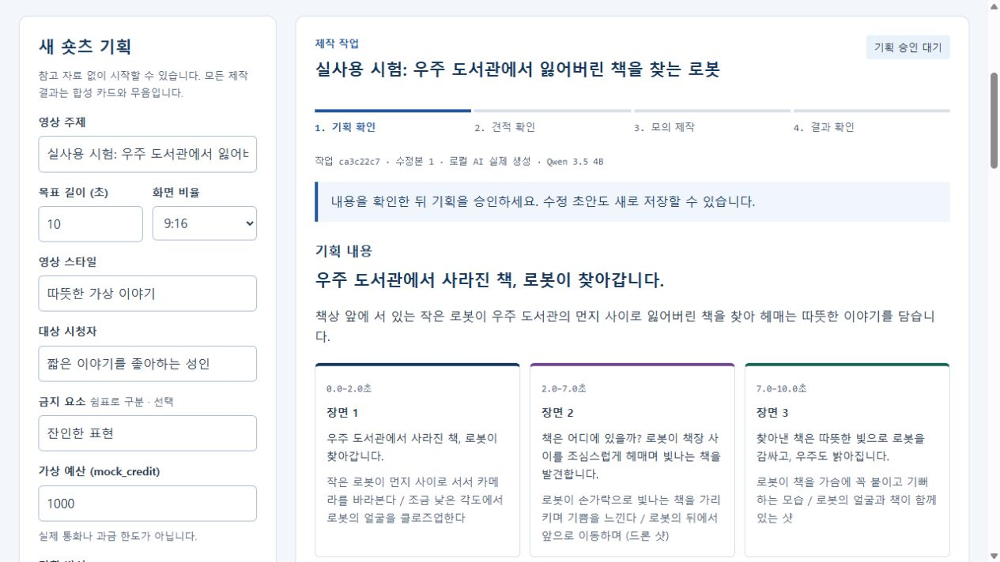
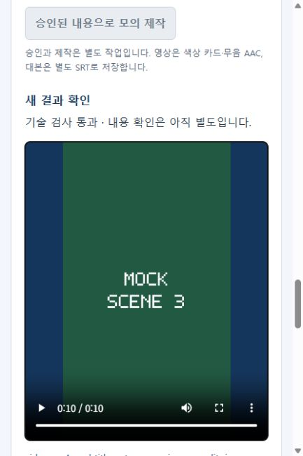

# 1. 프로젝트 개요

## 1.1. 기본 정보

- 프로젝트 제목 : 숏츠 제작을 위한 멀티 에이전트팀 개발
- 작성일자 : 2026-11-16
- 학번 / 이름 : 미기재

사용자가 주제와 조건을 입력하면 기획, 연출, 프롬프트 작성, 제작, 검토를 거쳐 숏츠 한 편을 만드는 에이전트팀을 개발하고 있다. 최종 결과물은 MP4 영상, SRT 자막, 장면별 JSON과 품질 검사 결과다. [저장소의 프로젝트 기획안](https://github.com/praksb2428-maker/Multi-Agent-Based-Video-Generation-Project/blob/9d8a72e1c928ba70112894768adef182cafa1bf8/Video_Production_Project.md)을 기준으로 진행 상황을 정리했다.

# 2. 현재까지 진행된 사항

## 2.1. 데이터 및 개발 환경 구축 현황

- 데이터셋 준비 상태 : 별도의 모델 학습은 진행하지 않고 기존 모델을 활용한다. 이를 시험할 수 있도록 시험용 주제·영상 조건·장면 정보와 정상·오류 응답 예제를 준비했다.
- 데이터 전처리 및 증강 : 주제, 목표 길이, 화면 비율, 스타일, 대상 시청자, 금지 요소, 가상 예산을 JSON으로 정리했다. 장면별 대본·배경·행동·카메라·길이의 누락과 형식을 검사하고, 장면 길이 합계가 목표의 ±10% 이내인지 확인하도록 했다.
- 개발 환경 세팅 : Windows에서 Python 3.12 가상환경과 CLI·로컬 웹 GUI를 구성했다. Ollama 0.40.16과 qwen3.5:4b-q4_K_M을 연결해 실제 기획·대본을 생성하고, FFmpeg·FFprobe로 모의 영상 제작과 기술 검사를 수행한다. OpenAI SDK는 실제 서버를 호출하지 않는 모의 응답 방식으로 준비했다.

## 2.2. 모델 개발 및 실험 결과

- 모델 파이프라인 구축 : 기획안의 네 Layer를 기준으로 다음 흐름을 연결했다.

  - Perception Layer : 사용자의 영상 조건과 누락·금지 항목을 확인한다. 보조 기능인 모의 자료 조사를 선택하면 참고 자료의 제목·주소·요약을 함께 저장한다.
  - Reasoning Layer : 로컬 모델로 훅·줄거리·장면별 대본을 생성한다. 기획 승인 후에는 현재 로컬 규칙으로 액션·비주얼 연출과 장면별 프롬프트를 정리한다.
  - Action Layer : 가상 견적을 제시하고, 기획 승인과 별도의 모의 제작 승인을 받은 뒤 사용자가 제작을 실행하면 FFmpeg로 모의 MP4와 SRT를 만든다.
  - Observation Layer : 영상 길이·해상도·자막 타이밍·파일 손상 여부를 검사하고, 사용자가 결과를 확인하거나 수정을 요청하도록 했다. 수정본은 새 버전으로 저장하며 기획·제작 승인을 다시 받는다.

  에이전트 역할과 JSON 전달 구조를 설계했으며, 현재 실행은 Python 순차 처리 방식이다. 여러 LLM 에이전트가 각각 판단하는 실행 구조는 아직 연결하지 않았다.

- 초기 실험(베이스라인) 결과 : GUI에서 실제 로컬 모델로 한국어 기획과 3개 장면의 대본을 생성했다. 두 승인을 거쳐 10초·360×640 모의 MP4를 만들고 브라우저에서 끝까지 재생했다. MP4·SRT·장면 JSON·품질 검사 결과의 저장을 확인했으며, 2026-11-16 로컬 기능 검증 기록에서 전체 테스트 143개가 통과했다. 영상은 색상 카드와 무음 오디오를 합성한 결과로, 실제 AI 영상·음성 생성이나 대본 내용의 적절성까지 검증한 것은 아니다.

  GitHub main에는 초기 콘텐츠 기획·기획 승인 단계가 올라가 있다. 위의 로컬 모델·GUI·모의 제작 실험은 이후 로컬 프로젝트에서 진행한 내용이며, 아직 저장소에 반영하지 않았다. [GitHub에 공개된 구현 범위](https://github.com/praksb2428-maker/Multi-Agent-Based-Video-Generation-Project/blob/9d8a72e1c928ba70112894768adef182cafa1bf8/README.md)

- 중간 결과물 예시 : 실제 로컬 모델의 기획 생성 화면과 승인 후 모의 영상을 재생한 화면이다. 두 화면은 UI 개편 전 기능 시험 기록이다.

그림 1. 주제와 조건을 입력해 생성한 기획·대본. 사용자 승인 전 초안으로 저장된다.

그림 2. 승인 후 제작한 모의 MP4의 재생 결과. 실제 AI가 만든 장면이나 내레이션은 포함하지 않는다.

## 2.3. 이슈 사항

- 발생한 문제 : 기획안에서는 11/9~11/15에 영상 생성·TTS 연결을 계획했지만, 현재는 모의 제작까지 진행했다. 로컬 모델 연결 중 JSON 규격 오류가 발생했고, 생성 대본에는 사실 확인이 필요한 표현도 있었다.
- 원인 분석 : 외부 제작 도구와 실제 비용을 확정하기 전에 승인·수정·검사 흐름을 비용 없이 검증하는 데 우선순위를 뒀다. JSON 오류는 Ollama가 일부 규격을 지원하지 않아 발생했으며, 형식 검사만으로 대본의 사실성까지 판단하기는 어렵다.
- 해결 방안 : JSON 규격을 수정해 실제 로컬 생성을 확인했고, 기획과 제작 승인을 분리했다. 실제 영상·TTS 연결은 도구와 비용을 별도로 결정한 뒤 진행한다. 내용의 적절성, 실제 영상의 인물·배경 일관성과 음성 동기화는 사용자 확인이 필요하다. GUI의 브라우저 자체 200% 확대 검사도 남아 있다.

# 3. 변경 사항

## 3.1. 변경 목표 및 범위

- 변경 전 : 콘텐츠 기획, 액션·비주얼 연출, 프롬프트 작성, 영상·음성 제작, 품질 검토를 연결해 숏츠 한 편을 완성하는 것을 목표로 했다.
- 변경 후 : 최종 목표와 결과물은 유지한다. 현재 단계는 로컬 모델의 실제 기획·대본 생성과 모의 견적·승인·제작·검사·수정 흐름 검증에 집중했다. GUI와 선택형 모의 자료 조사·출처 저장 기능도 추가했다.
- 변경 사유 : 과금 없이 전체 처리 흐름을 먼저 확인하고, 실제 제작 도구를 연결하기 전에 입력·승인·오류 처리와 결과 저장 구조를 갖추기 위해 개발 순서를 조정했다.

## 3.2. 변경 방법론 및 아키텍처

- 변경 내용 : 기획안에서 우선 검토한 gpt-4o-mini 대신 현재는 로컬 Qwen 모델로 기획·대본을 생성한다. 후보였던 CrewAI는 도입을 확정하지 않고 Python 기반 처리와 JSON 전달 구조를 유지했다. OpenAI SDK는 모의 연결만 준비했으며 실제 API나 Codex 생성 기능은 연결하지 않았다. 개발 과정은 계획 → 작성 → 검증 → 별도 검토 → 문서화로 나누고, 계획·검증·문서화 스킬을 .agents/skills/에 정리해 사용 기록을 남겼다. 실제 웹 검색과 RAG·벡터 DB는 도입하지 않았고, 모의 자료 조사는 기본 꺼짐 상태의 보조 기능으로 둔다.

# 4. 향후 계획

## 4.1. 세부 개발 일정

주차 항목은 보고서 양식을 유지했다. 아래 작업은 기획안에 남은 개발 일정인 11/16~11/22, 11/23~11/29, 11/30~12/6의 순서에 맞춰 진행할 계획이다.

- 9~10주차 : 품질 검사와 승인·예산 확인 기능을 보완하고, 수정 요청이 기획 수정·재승인·모의 재제작으로 이어지는 흐름을 점검한다. 실제 영상·음성 도구의 연결 여부와 비용은 별도로 결정한다.
- 11~12주차 : 여러 주제로 기획부터 모의 제작·검토까지 통합 시험한다. 목표 길이 ±10%, 장면 정보 누락, MP4 재생, SRT·JSON·검사 결과 저장을 확인한다. 실제 영상·음성 생성이 연결되면 별도 시험하고, 연결 전에는 모의 결과와 구분한다.
- 13~14주차 : 통합 시험에서 발견한 오류를 수정하고 실행 방법과 테스트 결과를 정리한다. 남은 GUI 확대 검사를 확인하고, 현재 구현 범위와 미완료 기능을 명시한 시연 영상·최종 보고서·발표 자료를 준비한다.
